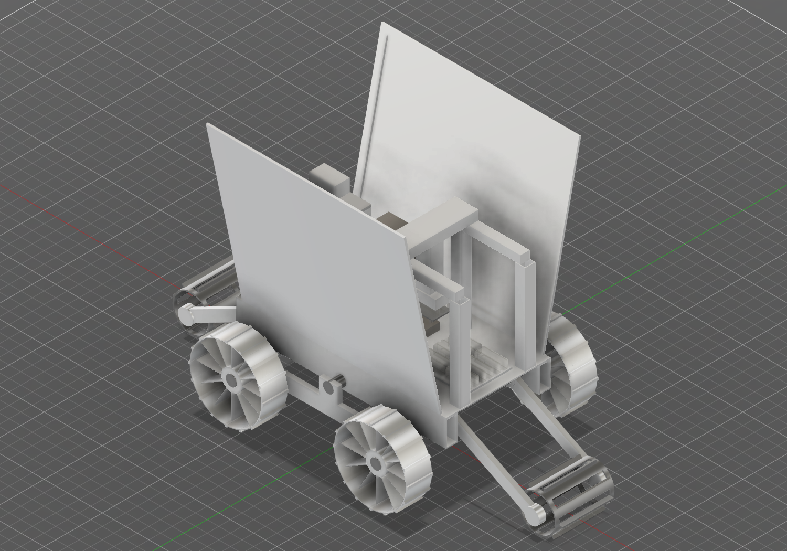
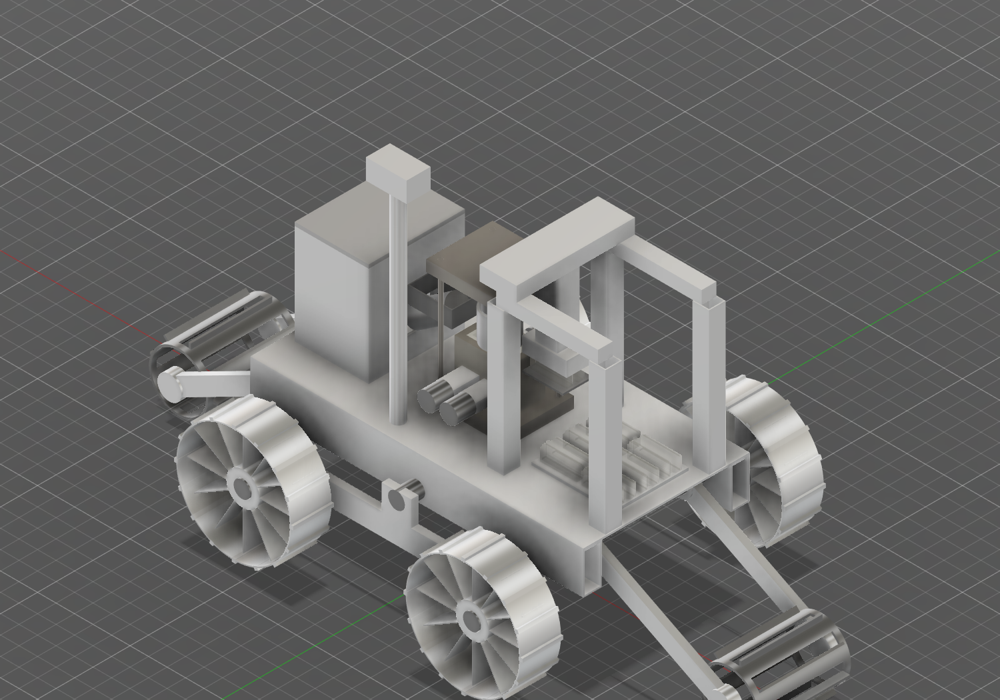
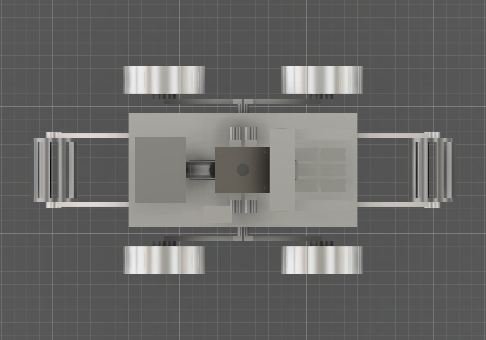
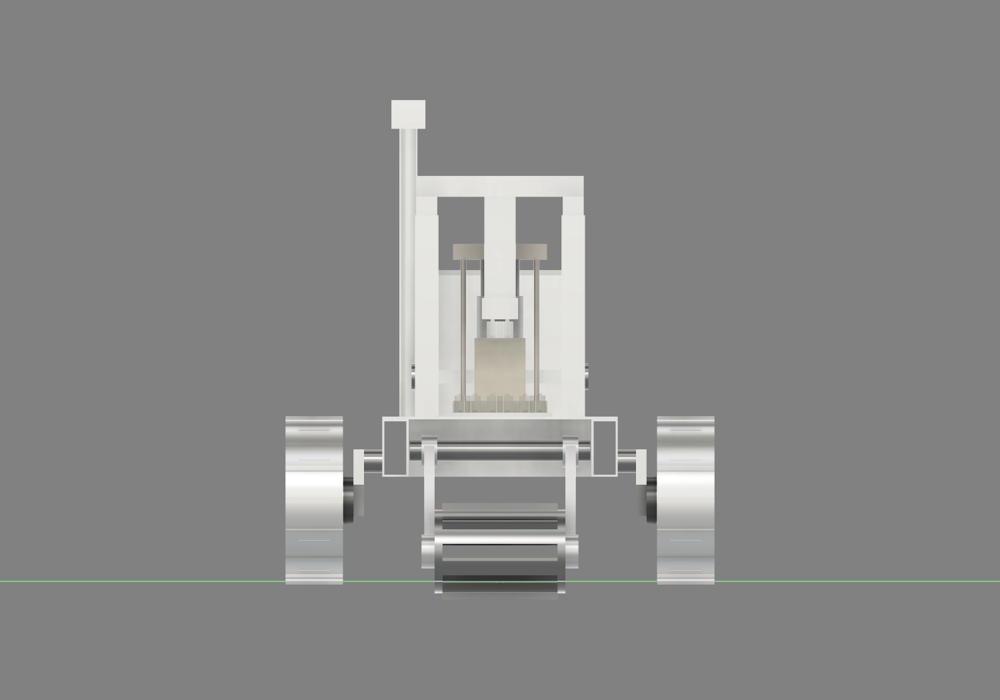

# Fusion Master Skill

A field-tested skill for controlling Autodesk Fusion through a local MCP server. It gives Codex and Claude Code the same CAD workflow, the same safety rules, and the same set of repeatable probes.



<table>
  <tr>
    <td width="50%"></td>
    <td width="50%"></td>
  </tr>
  <tr>
    <td align="center">Chassis and mechanism</td>
    <td align="center">Top view</td>
  </tr>
  <tr>
    <td colspan="2"></td>
  </tr>
  <tr>
    <td colspan="2" align="center">Right view</td>
  </tr>
</table>

## What is in here

- A manufacturing-aware CAD skill built around parametric design intent, stable references, and verification.
- A small dependency-free MCP client that validates Fusion Python before sending it.
- Reproducible labs for sketches, extrudes, patterns, fillets, chamfers, shells, components, joints, interference, materials, physical properties, revolve, loft, sweep, and simulation API discovery.
- A capability ledger that separates tested behavior from API surface that merely exists in the documentation.
- Project wiring for both Codex and Claude Code.

This is not a prompt that tells an agent to “make a model.” It is an operating manual for doing CAD work without quietly corrupting a document or accepting a feature just because Fusion says it is healthy.

## Why it exists

Fusion's Python API is powerful, but the MCP adapter has sharp edges. The probe suite found several that are easy to miss:

- A script without a fresh top-level `run(_context)` can execute the previous script again.
- MCP transport success can contain an inner Fusion failure.
- A healthy oversized fillet can erase the intended outer envelope.
- Initial sketch coordinates are not constraints.
- Some product and workspace calls throw where the installed docs say they return null.
- Simulation study creation can open a modal, block the MCP request, and still leave partial state after cancellation.

Those are documented as testable rules, not folklore.

## Current coverage

The repeatable lab has verified:

- named parameters and expression-driven dimensions;
- fully constrained circle and rectangle sketches;
- new-body, join, and cut extrusions;
- construction planes, circular patterns, fillets, chamfers, holes, and shells;
- separate components, occurrence transforms, grounding, and rigid as-built joints;
- physical properties, material assignment, bounding boxes, and feature health;
- revision/recompute/restore checks;
- zero and positive interference cases;
- undo and redo;
- revolve, loft, and sweep feature creation;
- simulation workspace initialization and precheck inspection.

Simulation is intentionally marked partial. The installed API can initialize and inspect studies, but the tested build did not provide a reliable headless load/constraint/solve/results loop. CAM, mesh conversion, exchange round-trips, drawings, sheet metal, and generative design remain discovery work rather than advertised features.

The full record is in [tested-capabilities.md](.agents/skills/fusion-cad-master/references/tested-capabilities.md).

## Requirements

- Autodesk Fusion running on Windows.
- A Fusion MCP adapter listening at `http://127.0.0.1:27182/mcp`.
- Python 3.10 or newer for the local probe scripts.
- Codex or Claude Code.

The local Python utilities use only the standard library. Fusion-side scripts import Autodesk's `adsk` modules inside Fusion.

## Use with Codex

Clone the repository and open Codex from its root. The canonical skill lives at:

```text
.agents/skills/fusion-cad-master/
```

Invoke it with `$fusion-cad-master`. To install it globally instead, copy that directory to your Codex skills directory.

## Use with Claude Code

The repository includes both `.mcp.json` and a Claude wrapper skill at:

```text
.claude/skills/fusion-cad-master/SKILL.md
```

Start Claude Code from the repository root, approve the project MCP server when prompted, then invoke `/fusion-cad-master`. The wrapper points back to the canonical skill so the two agents do not drift into different CAD habits.

Local permission files are deliberately excluded. Each user should review and approve their own MCP permissions.

## Smoke test

With Fusion and the adapter running:

```powershell
python .agents\skills\fusion-cad-master\scripts\fusion_mcp_probe.py list-tools
python .agents\skills\fusion-cad-master\scripts\fusion_mcp_probe.py run-script .agents\skills\fusion-cad-master\scripts\fusion\00_inventory.py
```

For an advanced API inventory without changing the model:

```powershell
python .agents\skills\fusion-cad-master\scripts\probe_advanced_api.py --area all
```

Run mutation and failure probes only in a marked disposable lab. The numbered suite and stopping rules are in [repeatable-framework.md](.agents/skills/fusion-cad-master/references/repeatable-framework.md).

## Repository layout

```text
.agents/skills/fusion-cad-master/   canonical Codex skill, references, and probes
.claude/skills/fusion-cad-master/  Claude Code wrapper
.mcp.json                          local Fusion MCP connection
docs/                              visual evidence from the capability lab
```

## Ground rules

- Inspect before changing geometry.
- Keep experiments out of a user's modified document.
- Never save, overwrite, export, close, or discard without the matching user intent.
- Query the installed API documentation before relying on a remembered signature.
- Verify geometry numerically and visually after every topology-changing step.
- Report what is unproven.

## License

MIT. See [LICENSE](LICENSE).
